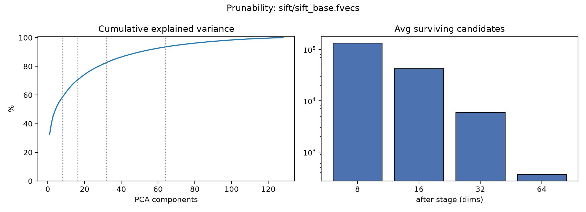

# Exact Nearest-Neighbor Search with Composable Lower Bounds

[](https://doi.org/10.5281/zenodo.22651064)
[](https://github.com/taiwuchiang-gmail/hierarchical-pca-search/actions/workflows/ci.yml)
[](https://opensource.org/licenses/MIT)

Exact nearest-neighbor search that is self-configuring, and that works both in
RAM and out of core. Some applications cannot accept a missed true neighbor
(deduplication, medical and legal retrieval, scientific analysis). For them,
the standard tool is a cheap **lower bound** on each candidate's distance: if
the bound already exceeds the best distance found so far, the candidate is
discarded without computing its full distance.

This repository composes two complementary families of exact bounds into one
cascade:

* a **PCA-truncation** bound (tight when variance concentrates in a few
  dimensions — linearly correlated data), and
* a **triangle-inequality ball** bound around k-means centroids (tight for
  clustered data, and exact for *any* centers, so clustering quality affects
  only speed, never correctness).

Because neither bound helps on all data, the index **configures itself from a
sample**: it picks the cascade widths from the eigenvalue curve, then a
three-tier diagnostic ("statistics nominate, measurement decides") rules on
each level. Exactness is verified on every query of every experiment.

### At a glance
* **3.9–20.8× less work** than a brute-force scan for exact 1-NN across four
  real datasets (96–1536 dimensions), with the wall-clock gain *growing* with
  dimensionality (2.6× at 128-D → 6.2× at 960-D).
* **Out of core:** exact cold-read queries run **7–17× faster** than a full
  disk scan and read **40–730× fewer bytes**, because the fetch set
  concentrates in a few k-means clusters.
* **ANN-class RAM residency, exactly:** only 8–40 bytes/vector of metadata
  stay resident (vs 512 B/vector for raw fp32), a 13–64× reduction.

### Papers
* **Merged manuscript** (primary, PVLDB Vol. 20 format) —
  [`pvldb/main.pdf`](pvldb/), Zenodo
  [10.5281/zenodo.22651064](https://doi.org/10.5281/zenodo.22651064). This is
  the current, complete write-up.
* Preliminary reports it supersedes: Paper I (hierarchical PCA pruning,
  [`paper1/`](paper1/),
  [10.5281/zenodo.21387358](https://doi.org/10.5281/zenodo.21387358)) and
  Paper II (composable bounds + self-configuring funnel, [`paper2/`](paper2/),
  [10.5281/zenodo.22199955](https://doi.org/10.5281/zenodo.22199955)).

## Installation

```bash
git clone https://github.com/taiwuchiang-gmail/hierarchical-pca-search.git
cd hierarchical-pca-search
pip install .
```

Only NumPy is required. `pip install ".[full]"` adds the optional extras:
scikit-learn (faster offline k-means fit; a pure-NumPy fallback is built in),
matplotlib (diagnostic plots), and joblib/tqdm (used by `benchmark.py`).
Installation also provides the `pca-diagnose` command-line tool.

## Quick Start (Benchmarking)

To run the SIFT1M benchmark and reproduce the PCA-only cascade (the simplest
entry point; see the tables above and `knn_bench.py` / `ooc_bench.py` for the
full hybrid, k-NN, and out-of-core results):

```bash
python benchmark.py
```

**What this script does automatically:**
1. Downloads and extracts the [SIFT1M dataset](http://corpus-texmex.irisa.fr/) (if not present).
2. Fits a PCA model on the 1,000,000 base vectors and saves it (offline indexing).
3. Runs 100 randomly selected queries using both the **Vectorized Brute-Force Baseline** and the **Hierarchical PCA Search**.
4. Verifies 100% exactness (zero false dismissals).
5. Generates a logarithmic bar chart (`figures/pruning_effectiveness.png`) showing the candidate drop-off at each dimensional cascade.

## Will it help *your* data? (prunability diagnostic)

The speedup depends entirely on how **correlated** your dimensions are: correlated data
concentrates variance in a few PCA components (fast eigenvalue decay), which makes the
low-dimensional lower bounds tight and the pruning aggressive. Uncorrelated data (flat
eigenvalue spectrum) gives loose bounds and no benefit.

`diagnose.py` measures this on a sample of *your* vectors in seconds, before you
integrate anything:

```bash
python diagnose.py your_vectors.npy        # or .fvecs
python diagnose.py --demo                  # synthetic tour: watch the verdict flip
                                           # as correlation weakens
```

It reports the eigenvalue decay, runs the actual pruning cascade on the sample
(verifying exactness against brute force), and prints measured survivor rates, the
fraction of full vectors touched (your out-of-core I/O cost), a wall-clock speedup,
and a plain verdict:

```
VERDICT: STRONG   -- highly correlated data; pruning will pay off.
VERDICT: POOR     -- dimensions too uncorrelated (flat eigenvalue decay);
                     bounds are loose, use brute force / ANN instead.
```

Rule of thumb: if 95% of the variance fits in a small fraction of the dimensions,
this method will prune hard; if it needs nearly all dimensions, it won't. Only
numpy is required (matplotlib optional, for `--plot decay.png`).

### Validation: the diagnostic reproduces the paper's SIFT1M results

Running `diagnose.py` on the full SIFT1M base set recovers the paper's measured
cascade stage-by-stage, from a single command:

| stage | paper (Fig. 1) | `diagnose.py` (1M) |
|---|---|---|
| after 8D | 146,955 (14.7%) | 135,356 (13.5%) |
| after 16D | 52,107 (5.2%) | 42,322 (4.2%) |
| after 32D | 7,896 (0.8%) | 5,953 (0.6%) |
| after 64D | 564 (0.056%) | 366 (0.04%) |
| speedup | 4.3x | 5.0x |
| exactness | 100% | 100/100 |

(Small deltas are expected: the diagnostic uses held-out base vectors as queries,
so it works on any `.npy`/`.fvecs` file without a separate query set.)



The left panel is the cause (SIFT's first 8 PCA dims hold 58.5% of the variance —
strongly correlated dimensions); the right panel is the effect (candidates drop
four orders of magnitude through the cascade).

## Hybrid index: ball (k-means) bound + PCA cascade

`hybrid_search.py` adds a second, complementary family of exact lower bounds.
For a point `p` in a k-means cluster with centroid `c` (and stored offline
distance `d_p = ||p - c||`), the triangle inequality gives:

```
||q - p||  >=  | ||q - c|| - d_p |
```

This bound needs **no distance computations at query time** — one gather and
one subtraction per point, after `k << N` centroid distances. It is exact for
*any* centers (quality only affects speed, never correctness), and it is tight
exactly where the PCA bound is loose: clustered / multimodal data. The hybrid
query runs the ball level first, then the PCA cascade on the survivors.

```bash
python hybrid_search.py demo             # PCA-hostile vs PCA-friendly showcase
python hybrid_search.py sift             # SIFT1M, official queries
python knn_bench.py gist auto            # k in {1,10,100}, eigen-curve levels
```

Exact **k-NN** is supported: `idx.query(q, k=10)` returns the k nearest
neighbors (sorted, verified exact against brute force in the test suite).
The dynamic pruning radius generalizes from the best evaluated distance to
the k-th best over distinct evaluated points.

### Results on four real datasets

Exact 1-NN, eigen-curve-selected levels, PCA-only cascade. Work is counted in
per-dimension distance terms; a brute-force scan is `n·d` terms by definition,
so the "work reduction" column is hardware-independent. Every query is exact.

| dataset | n × d | wall-clock | work reduction | funnel verdict |
|---|---|---|---|---|
| SIFT1M | 1M × 128 | 2.6× | 10.2× | STRONG |
| GIST1M | 1M × 960 | **6.2×** | **20.8×** | STRONG |
| DBpedia-OpenAI (ada-002) | 1M × 1536 | 6.0× | 12.8× | STRONG |
| DEEP10M | 10M × 96 | 1.2× | 3.9× | MODERATE |

The wall-clock gain *grows with dimensionality*: brute force pays the full
dimension per point, while the cascade pays only for the data's intrinsic
structure. k-NN wins up to k≈10 and honestly loses in RAM at k=100 (the
pruning radius grows with k). The 1536-D OpenAI embeddings only prune once
the cascade widths follow the eigen curve; with a fixed `(8,16,32,64)` ladder
the same data reads as unprunable.

### Out of core: exact search cheaper than a disk scan

`ooc_bench.py` builds a two-tier on-disk layout (a resident sketch + metadata,
plus a cluster-major data file) and measures exact cold-read queries under
`O_DIRECT` against a full disk scan. Because a query's nearest neighbors are
near each other, its fetch set concentrates in a few k-means clusters (27 of
1024 on the OpenAI embeddings), so the layout turns the final fetch into a few
large reads:

| dataset | scan | point-fetch | block-fetch | fewer bytes |
|---|---|---|---|---|
| DBpedia-OpenAI | 5385 ms | **318 ms (17×)** | 418 ms (13×) | 730× |
| GIST1M | 3006 ms | 421 ms (7×) | 751 ms (4×) | 40× |
| SIFT1M | 402 ms | 61 ms (7×) | 81 ms (5×) | 212× |

```bash
python ooc_bench.py build dbpedia_openai_1M.npy   # write the two-tier layout
python ooc_bench.py run   dbpedia_openai_1M.npy    # timed 3-arm cold-read bench
python locality_stats.py  gist auto                # how cluster-local is the fetch set?
```

The k-means structure earns its place as a **partitioner** for the on-disk
layout even on datasets where the funnel rejects it as a *pruning level*.

### The self-configuration funnel

`diagnose.py` decides, from a sample of *your* vectors and in seconds, which
levels this index should have — including the cascade widths, picked from the
eigenvalue curve. A three-tier funnel: (1) the eigen curve rates the PCA
levels and picks the widths, (2) kurt(PCA)/sqdep statistics detect structure
beyond the covariance, and (3) a measured trial of the real hybrid cascade on
your sample delivers the verdict (`ADD` / `SKIP`) — because the statistics
nominate but the measurement decides. On SIFT the ball level's verdict is a
`SKIP` (it prunes only ~50%, and the bound work cancels the saving — a
wall-clock tie), while on clustered data with a flat eigen-spectrum the same
level dominates (hybrid **13.9×** vs 2.1× for PCA-only).

A statistical baseline, ADSampling (SIGMOD 2023), is measured in the same work
currency in [`adsampling_bench.py`](adsampling_bench.py): in RAM the two are
mixed, but ADSampling must touch every vector (its Δd=32 floor), so it cannot
leave RAM — where our deterministic bounds fetch only 0.06–1% of the vectors.

## Understanding the Code

`hybrid_search.py` holds the main composed index (`HybridIndex`): the ball
level, the PCA cascade, the re-probe, exact k-NN, and the `count_ops` work
accounting. `benchmark.py` is the simpler PCA-only reference implementation
from Paper I; its core is `hierarchical_pca_1nn_l2`.

Both use a **Top-50 Probe**: at the coarsest representation (8D), the 50
closest candidates get their full distance computed immediately. The minimum
of those 50 is a mathematically guaranteed, tight radius for pruning the rest
— safe from the first comparison on, with no prior knowledge of the neighbor
distance.

## Tests

The exactness guarantee is enforced by an automated test suite (no dataset
download needed — it runs on synthetic data in a few seconds):

```bash
pip install -e ".[test]"
pytest
```

It verifies, per query and on three data regimes (clustered / low-rank /
i.i.d.), that every query path returns the brute-force nearest neighbor,
checks the `count_ops` work accounting against hand-computed values, and
exercises the diagnostic funnel's verdicts. CI runs the suite on every push,
including once without scikit-learn to cover the pure-NumPy k-means fallback.

## Contributing

Bug reports and pull requests are welcome — see
[CONTRIBUTING.md](CONTRIBUTING.md). The one non-negotiable invariant: bound
quality may affect speed, never correctness.

## Citation

If you use this code in your research, please cite the merged manuscript (the
concept DOI always resolves to the latest version):

```bibtex
@misc{chiang2026composable,
  title={Exact Nearest-Neighbor Search with Composable Lower Bounds:
         Self-Configuring Hierarchical Pruning, In RAM and Out of Core},
  author={Chiang, Tai-Wu},
  publisher={Zenodo},
  year={2026},
  doi={10.5281/zenodo.22651064},
  url={https://doi.org/10.5281/zenodo.22651064}
}
```

The earlier preliminary reports have their own DOIs: Paper I
(10.5281/zenodo.21387358) and Paper II (10.5281/zenodo.22199955).

## License
[MIT](LICENSE)
